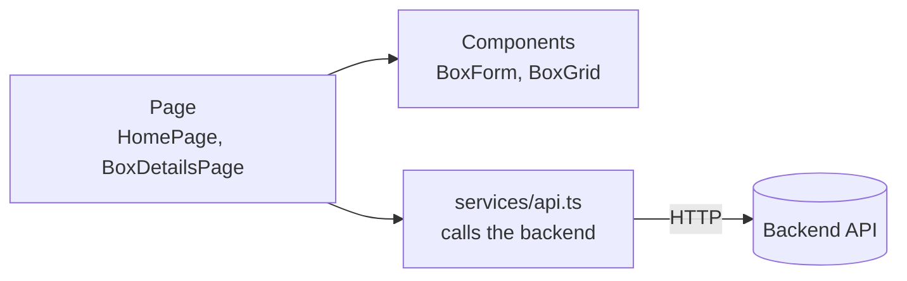
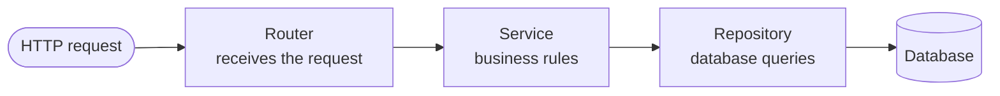

# BoxBrain

Remembers what is inside your boxes, suitcases, containers and drawers, and where you put them. Search "where is my passport?" and get the box and its location. Built as a REST API with FastAPI and a React frontend, deployed on Vercel.

> **Status:** MVP (`v0.1.0`). The box CRUD API (`/api/v1/boxes`) and an Ant Design frontend work locally with SQLite and in production with Supabase PostgreSQL; accounts, households, QR labels and moving mode are planned for the Beta.

## Features

**MVP** (demo before mid-term)
- Add a box with its number, label, location, contents (one item per line), notes and the date it was last opened
- List boxes (by number), view one, edit it and delete it through a REST API (`/api/v1/boxes`)
- "Where is my X?" search across every box's label, location and contents
- Flag and filter boxes not opened for 12 months; mark a box as "opened today"
- Input validation with clear error responses (box numbers are unique)
- Interactive API docs at `/api/docs`

**Beta** (demo before final)
- Sign up and log in (JWT access token + refresh token)
- Private households shared with family or flatmates, with `owner` and `member` roles
- QR label for each box: scan it with a phone camera to open the box page
- Nested locations, photos, box history and moving mode
- Roles: `user` and `admin`; admin dashboard with stats, ban / unban users
- Security: Argon2 password hashing, login lockout, rate limits, security headers

## Tech stack

| Part | Choice |
|---|---|
| Backend | Python 3.10+, FastAPI, SQLModel |
| Database | Supabase PostgreSQL (production), SQLite (local) |
| Frontend | React + TypeScript + Vite, Ant Design (custom orange theme, card layout), React Router |
| Hosting | Vercel (frontend and backend in one project) |
| Beta extras | Alembic (migrations), PyJWT, Argon2, Supabase Storage, segno (QR codes) |

## Documentation

| Doc | What it covers |
|---|---|
| [PRD — Product Requirements Document](docs/01-prd.md) | Goals, features, user stories, milestones |
| [SRS — Software Requirements Specification](docs/02-srs.md) | Functional and non-functional requirements, permissions, acceptance criteria |
| [TDD — Technical Design Document](docs/03-tdd.md) | Architecture, data model, API endpoints, auth and security design |

## Project structure

```
backend/    FastAPI app (routes under /api)
frontend/   Vite + React + TypeScript
docs/       PRD, SRS, TDD (product requirements, software requirements, technical design)
vercel.json Vercel setup: /api/* goes to backend, everything else to frontend
AGENTS.md   Branch, commit and PR conventions
```

## How it works

### Frontend



A page shows the screen and keeps its data, components draw the pieces, and `services/api.ts` is the only place that talks to the backend.

### Backend



Each layer has one job: the router handles HTTP, the service decides what is allowed (for example, box numbers must be unique), and the repository reads and writes the database. The response goes back up the same way.

### REST API

| Method | Path | What it does |
|---|---|---|
| `POST` | `/api/v1/boxes` | Create a box (201; 409 if the number is taken) |
| `GET` | `/api/v1/boxes?offset=0&limit=20` | List boxes by number, with `total` |
| `GET` | `/api/v1/boxes/{id}` | Read one box (404 if missing) |
| `PATCH` | `/api/v1/boxes/{id}` | Update only the fields sent, e.g. `last_opened_on` |
| `DELETE` | `/api/v1/boxes/{id}` | Delete a box (204) |

## Requirements

- [Python](https://www.python.org/downloads/) 3.10+
- [Node.js](https://nodejs.org/) 22+

> On macOS/Linux, use `python3` instead of `python`.

## Run locally

You need two terminals: one for the backend and one for the frontend. Boxes are saved in a local SQLite file, `backend/boxbrain.db`, which is created automatically on the first run and is not committed.

### First time (initial setup)

Run this once after cloning the repo.

**Backend** (terminal 1):

```bash
cd backend
python -m venv .venv
.venv\Scripts\Activate.ps1      # macOS/Linux: source .venv/bin/activate
pip install -r requirements.txt
fastapi dev main.py
```

**Frontend** (terminal 2):

```bash
cd frontend
npm install
npm run dev
```

### Running again (after the initial setup)

The virtual environment and `node_modules` already exist, so skip the install steps.

**Backend** (terminal 1):

```bash
cd backend
.venv\Scripts\Activate.ps1      # macOS/Linux: source .venv/bin/activate
fastapi dev main.py
```

**Frontend** (terminal 2):

```bash
cd frontend
npm run dev
```

Run `pip install -r requirements.txt` or `npm install` again only when someone adds or changes a dependency.

Open http://localhost:5173. Vite forwards `/api` requests to the backend on port 8000. API docs: http://localhost:8000/api/docs.

> Add new Python packages to `backend/requirements.txt`.

> **Reset the data:** stop the backend and delete `backend/boxbrain.db`.

## Environment variables

Locally nothing needs to be set: the app uses the SQLite file `backend/boxbrain.db`. In production (Vercel) the app uses Supabase PostgreSQL. Set variables in Vercel under **Project → Settings → Environment Variables** (a local `.env` is never committed).

| Variable | Needed for | Notes |
|---|---|---|
| `DATABASE_URL` | MVP (production) | Supabase transaction pooler URL (port `6543`), e.g. `postgresql://postgres.<ref>:<password>@aws-0-<region>.pooler.supabase.com:6543/postgres`. Leave unset locally to use SQLite. Vercel cannot keep a SQLite file between requests, so without a hosted database the deployed app loses its data. |
| `POSTGRES_URL` | MVP (production) | Set automatically by the Supabase integration on Vercel. Used when `DATABASE_URL` is not set; `postgres://` and the Supabase-only `supa=` parameter are handled for you. |
| `JWT_SECRET` | Beta | Long random string, e.g. `python -c "import secrets; print(secrets.token_urlsafe(48))"` |
| `ACCESS_TOKEN_MINUTES` | Beta | Default `15` |
| `REFRESH_TOKEN_DAYS` | Beta | Default `7` |

Never commit secrets or `.env` files. See [TDD, section 15](docs/03-tdd.md#15-supabase-setup) for the Supabase setup.

## Deploy to Vercel

1. Push the repo to GitHub.
2. Go to https://vercel.com/new, import the repo and click **Deploy**. Keep **Root Directory** as `./`.
3. Add `DATABASE_URL` (see above) and redeploy.

Every push to `main` redeploys automatically.

## Contributing

Every change starts from a GitHub issue. Branch, commit and pull request rules are in [AGENTS.md](AGENTS.md):

- Branch: `Zarin/#{issue_number}-{task_title}`
- Commit: `<type>: <summary> (#issue)`, e.g. `feat: add box crud api with sqlmodel and validation (#4)`
- One pull request per issue, with `Closes #{issue_number}` in the description

## Troubleshooting

- **"Running scripts is disabled" in PowerShell:** run `Set-ExecutionPolicy -Scope CurrentUser RemoteSigned`.
- **`fastapi` not found:** activate the virtual environment first.
- **`ModuleNotFoundError: sqlmodel`:** run `pip install -r requirements.txt` inside the activated virtual environment.
- **Boxes look wrong or the database is corrupted:** stop the backend and delete `backend/boxbrain.db`; it is recreated on the next start.
- **`Request failed: 500` in the app:** the backend isn't running, or `DATABASE_URL` is wrong.
- **App at localhost:8000 shows an old version:** delete `frontend/dist`.
- **Vercel build fails:** check **Build Logs** in the Vercel dashboard, and make sure `npm run build` works in `frontend/`.
