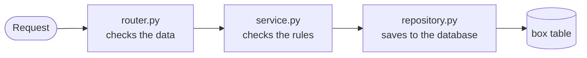

# BoxBrain

I keep a lot of things in boxes: winter clothes, old documents, kitchen extras. Every time I need something, I end up opening five boxes to find it. BoxBrain fixes that. You give every box a number, write down what is inside and where the box is kept, and then you search for the thing ("passport") instead of digging through boxes.

This is my course project (Zarin Tasnim, 2311933). The backend is FastAPI, the frontend is React with Ant Design, and the whole thing runs on Vercel with a Supabase database.

**Status:** MVP, version `0.1.0`. You can add, view, edit and delete boxes, search everything, and see which boxes nobody has opened for a year. Accounts, shared households and QR labels are planned for the Beta.

## What it can do

**In the MVP (mid-term):**

- Add a box with its number, a label, where it is kept, what is inside (one thing per line), optional notes and the day it was last opened
- See all boxes as cards, open one to see its details, edit it or delete it
- Search across labels, locations and contents ("where is my passport?")
- Show only the boxes that have not been opened for 12 months, and mark a box as "opened today" with one click
- Light and dark mode
- Clear error messages, for example when a box number is already used

**Planned for the Beta (final):**

- Sign up and log in
- Private households that you can share with family or flatmates
- A QR label for every box: scan it with your phone to open the box page
- Rooms inside locations, photos, box history and a "moving house" mode
- An admin page, and better security (password hashing, rate limits, login lockout)

## Built with

| Part | What I used |
|---|---|
| Backend | Python, FastAPI, SQLModel |
| Database | Supabase PostgreSQL online, a SQLite file on my laptop |
| Frontend | React, TypeScript, Vite, Ant Design (forms and pop-ups), my own CSS for the look, React Router |
| Hosting | Vercel (frontend and backend in one project) |

## Documents

- [PRD](docs/01-prd.md): what the product is and who it is for
- [SRS](docs/02-srs.md): the exact requirements
- [TDD](docs/03-tdd.md): how it is built (section 1.1 describes the MVP as it is now)

## Folders

```
backend/
  main.py            starts the app
  app/config.py      decides which database to use
  app/database.py    connects to the database
  app/boxes/         everything about boxes:
    models.py          the box table
    schemas.py         what the API accepts and sends back
    repository.py      the database queries
    service.py         the rules (unique number, no future dates)
    dependencies.py    small helpers for the routes
    router.py          the API routes
frontend/src/
  main.tsx           starts React
  App.tsx            colours, top bar, footer and the page for each URL
  api.ts             every call to the backend
  types.ts           the shape of a box
  helpers.ts         small helpers (items inside a box, dates, the form, box colours)
  styles.css         BoxBrain's own colours and layout
  components/        TopBar, Summary (the number tiles), BoxCard, BoxForm
  pages/             HomePage, BoxPage
docs/                PRD, SRS, TDD
vercel.json          sends /api/... to the backend and everything else to the frontend
```

## How a request travels

When you click "Save box", the page calls `api.ts`, which sends the request to `/api/v1/boxes`. On the backend it goes through three steps:



If the data is wrong (for example, an empty label), the answer is `422`. If a rule is broken (a box number that is already used, or a "last opened" date in the future), the answer is `409`. Otherwise the saved box comes back as JSON.

## API

| Method | URL | What it does |
|---|---|---|
| `GET` | `/api/v1/boxes?offset=0&limit=20` | List boxes sorted by number, plus the total count |
| `POST` | `/api/v1/boxes` | Add a box (`201`, or `409` if the number is used) |
| `GET` | `/api/v1/boxes/{id}` | One box (`404` if it doesn't exist) |
| `PATCH` | `/api/v1/boxes/{id}` | Change only the fields you send |
| `DELETE` | `/api/v1/boxes/{id}` | Delete a box (`204`) |

While the backend runs, you can try every route at `/api/docs`.

## Running it on your computer

You need Python 3.10 or newer and Node.js 22 or newer. Open two terminals.

**Terminal 1, backend:**

```bash
cd backend
python -m venv .venv
.venv\Scripts\Activate.ps1        # on Mac/Linux: source .venv/bin/activate
pip install -r requirements.txt
fastapi dev main.py
```

**Terminal 2, frontend:**

```bash
cd frontend
npm install
npm run dev
```

Then open http://localhost:5173.

The next time, you can skip `python -m venv`, `pip install` and `npm install`. Just activate the virtual environment and run `fastapi dev main.py` and `npm run dev`.

On your computer the boxes are saved in `backend/boxbrain.db`. It is created automatically the first time. To start over with no boxes, stop the backend and delete that file.

## Putting it online

1. Import the GitHub repo on https://vercel.com/new and deploy (leave Root Directory as `./`).
2. In the Vercel project, open **Settings → Environment Variables** and add `DATABASE_URL`. Its value is the Supabase "Transaction pooler" connection string (port `6543`). If you connect Supabase through Vercel's integration, `POSTGRES_URL` is added for you and works too.
3. Redeploy. After that, every push to `main` deploys again on its own.

Never put the database password in the code or commit a `.env` file.

## How I work on it

Every change starts as a GitHub issue. I make a branch named `Zarin/#<issue number>-<short title>`, write commits like `feat: add box crud api (#4)`, and open one pull request per issue with `Closes #<issue number>` in the description.

## If something goes wrong

- **PowerShell says running scripts is disabled:** run `Set-ExecutionPolicy -Scope CurrentUser RemoteSigned` once.
- **`fastapi` is not found:** the virtual environment is not active. Activate it first.
- **The page says `Request failed (500)`:** the backend is not running, or `DATABASE_URL` is wrong.
- **localhost:8000 shows an old version of the page:** delete the `frontend/dist` folder.
- **The Vercel build fails:** open the build logs on Vercel, and check that `npm run build` works inside `frontend/`.
