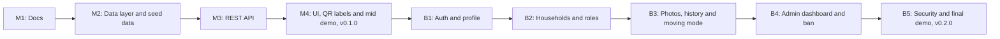

# Product Requirements Document (PRD): BoxBrain

| | |
|---|---|
| **Product** | BoxBrain |
| **Document** | Product Requirements Document (PRD) |
| **Version** | 1.0 |
| **Date** | October 2026 |
| **Author** | Rifat |
| **Related docs** | [SRS](02-srs.md) · [TDD](03-tdd.md) |

---

## 1. Overview

BoxBrain is a web app that remembers what is inside your boxes and where those boxes are. You give each physical container (cardboard box, suitcase, plastic container, drawer, cupboard) a number and a list of contents, put it in a location, and stick a printed QR code on it. Later you scan the QR code with your phone camera and see what's inside without opening it, or you search for an item and BoxBrain tells you which box it's in and where that box is.

Example box:

```
BOX 17
📍 Storage Room
🏷️ Winter clothes

Contents:
• 3 sweaters
• Jacket
• Scarf
• Gloves
• Boots
```

Example search:

```
Search: passport
→ Box 4 "Documents" → Bedroom → Cupboard → Top shelf
```

There are already many general "where did I put it?" apps. BoxBrain focuses on one narrower case: **physical boxes, QR labels and moving or long-term storage**.

## 2. Release plan

The product is built in two releases. Every feature, story and milestone in this document is tagged **MVP** or **Beta**.

| Release | When | Tag | Focus |
|---|---|---|---|
| **MVP** | Demo before mid-term | `v0.1.0` | Locations, boxes and items (CRUD), QR labels, scan to open a box page, search with location path, "not opened for 12 months" filter. One shared inventory, no accounts. |
| **Beta** | Demo before final | `v0.2.0` | Accounts, private households shared with family or flatmates (`owner` / `member`), photos, box history, moving mode, label sheets, fuzzy search, admin dashboard and ban, security hardening. |



## 3. Problem statement

People keep things in cardboard boxes, suitcases, plastic containers, cupboards, drawers and storage rooms, and then forget what is inside. The usual result:

- Opening five boxes to find one thing.
- Buying something again because you can't find the one you already own.
- Writing "MISC" on a box with a marker, which helps nobody six months later.
- During a move, not knowing which box has the kettle, the chargers or the documents.
- Boxes that sit in storage for years because no one remembers what's in them.

A handwritten list taped to the box only works if you can reach the box. A notes app works until the list gets long and the box numbers stop matching. What's missing is one place that links **box → contents → location**, plus a quick way to get from the physical box to its list.

## 4. Goals

| ID | Goal | Release |
|---|---|---|
| G-01 | Record any container with a number, label, type, location and list of contents in under two minutes. | MVP |
| G-02 | Get from a physical box to its contents in one scan with a normal phone camera. | MVP |
| G-03 | Answer "where is my X?" with the box and the full location path. | MVP |
| G-04 | Show boxes that haven't been opened for a chosen time (default 12 months). | MVP |
| G-05 | Keep each person's or family's inventory private behind an account. | Beta |
| G-06 | Let a household (family, flatmates) share one inventory with clear roles. | Beta |
| G-07 | Make moving house easier with a moving mode and printable label sheets. | Beta |

## 5. Target users

| User | Description | Main need |
|---|---|---|
| **Home organiser** | Keeps seasonal clothes, documents, tools and keepsakes in boxes and cupboards. | Find things without opening every box. |
| **Person moving house** | Packing dozens of boxes in a short time. | Label boxes fast, know what's in each, track what's unpacked. |
| **Student in a hostel or shared flat** | Stores things in suitcases and under beds, sometimes shares storage. | Small, quick inventory; share some boxes with flatmates. |
| **Household member** (Beta) | Family member or flatmate invited to a shared inventory. | See and update shared boxes. |
| **Admin** (Beta) | Runs the service. | See usage numbers and ban abusive accounts, without reading anyone's private inventory. |

## 6. Scope

### 6.1 In scope

| Release | In scope |
|---|---|
| **MVP** | Nested locations (room → cupboard → shelf); boxes with number, label, type, location and notes; items with name, quantity and notes; move boxes and items; QR code per box and a printable label; scanning the QR opens the box page; search items and box labels with the location path; "mark as opened" and the "not opened since" filter; one shared inventory with no accounts; Supabase PostgreSQL in production (SQLite locally); deployment on Vercel. |
| **Beta** | Sign up / login (JWT + refresh token); profile (change name and password); global roles `user` / `admin`; households with `owner` / `member` roles; photos of boxes and items; box history (created, opened, moved, edited); moving mode (packed, in transit, unpacked, destination); label sheets with several QR labels per page; fuzzy search that tolerates typos; admin dashboard with stats; ban / unban users; rate limiting, login lockout and other security hardening. |

### 6.2 Out of scope (this semester)

- Automated tests and CI/CD
- Native mobile apps (the web app works on phone browsers)
- An in-app camera scanner (the phone's normal camera already opens QR links)
- Offline mode
- Barcode scanning of products, price tracking, insurance valuation
- Email or push notifications

## 7. Features

Priority uses MoSCoW: **M**ust, **S**hould, **C**ould, **W**on't (this semester).

| ID | Feature | Priority | Release |
|---|---|---|---|
| F-01 | Nested locations (create, rename, move, delete) | Must | MVP |
| F-02 | Boxes with number, label, type, location and notes | Must | MVP |
| F-03 | Items inside boxes with name, quantity and notes | Must | MVP |
| F-04 | Move a box to another location, or an item to another box | Must | MVP |
| F-05 | QR code per box and a printable label | Must | MVP |
| F-06 | Scan QR → box page | Must | MVP |
| F-07 | Search "where is my X?" with box and location path | Must | MVP |
| F-08 | Mark as opened and "not opened since" filter | Must | MVP |
| F-09 | Box list with filters (location, type, text) | Must | MVP |
| F-10 | Sign up / login, JWT + refresh token | Must | Beta |
| F-11 | Profile: change name and password | Must | Beta |
| F-12 | Households with `owner` / `member` roles | Must | Beta |
| F-13 | Global roles `user` / `admin` | Must | Beta |
| F-14 | Photos of boxes and items | Should | Beta |
| F-15 | Box history | Should | Beta |
| F-16 | Moving mode (packed, in transit, unpacked, destination, progress) | Should | Beta |
| F-17 | Label sheets (several QR labels per A4 page) | Should | Beta |
| F-18 | Fuzzy search (tolerates typos) | Could | Beta |
| F-19 | Admin dashboard with stats, ban / unban | Must | Beta |
| F-20 | Security hardening (rate limits, lockout, headers, CORS) | Must | Beta |
| F-21 | In-app camera scanner | Won't | – |
| F-22 | Offline mode | Won't | – |

## 8. User stories

### 8.1 MVP

| ID | User story |
|---|---|
| US-01 | As a home organiser, I want to create locations inside other locations (Bedroom → Cupboard → Top shelf), so that I can describe exactly where a box is. |
| US-02 | As a home organiser, I want to create a box with a number, label, type and location, so that each physical container has a record. |
| US-03 | As a home organiser, I want to add, edit and remove items in a box, so that its contents list stays correct. |
| US-04 | As a home organiser, I want to print a QR label for a box, so that I can stick it on the physical box. |
| US-05 | As a home organiser, I want to scan a box's QR code with my phone camera and see its contents, so that I don't have to open it. |
| US-06 | As a home organiser, I want to search for an item like "passport" and see the box and its full location path, so that I can go straight to it. |
| US-07 | As a home organiser, I want to move a box to another location in the app, so that the record matches where it really is. |
| US-08 | As a home organiser, I want to move an item from one box to another, so that the lists stay correct when I repack. |
| US-09 | As a home organiser, I want to mark a box as opened, so that BoxBrain knows when I last used it. |
| US-10 | As a person moving house, I want to see all boxes that haven't been opened for 12 months (or another period), so that I can decide what to donate or throw away. |
| US-11 | As a home organiser, I want to browse boxes by location and filter by type, so that I can see what's stored in one room or cupboard. |
| US-12 | As a home organiser, I want to delete boxes and empty locations, so that old records don't clutter the app. |

### 8.2 Beta

| ID | User story |
|---|---|
| US-13 | As a new user, I want to sign up with my email and a password, so that my inventory is private. |
| US-14 | As a user, I want to log in and stay logged in, so that I don't have to sign in every time I scan a box. |
| US-15 | As a user, I want to change my name and password, so that my account stays correct and secure. |
| US-16 | As a household owner, I want to create a household and invite my family or flatmates by email, so that we share one inventory. |
| US-17 | As a household owner, I want to remove members, and as a member, I want to leave a household, so that access stays up to date. |
| US-18 | As a user, I want to add a photo to a box or item, so that I can recognise things quickly. |
| US-19 | As a user, I want to see a box's history (created, opened, moved, edited and by whom), so that I know what happened to it. |
| US-20 | As a person moving house, I want to mark boxes as packed, in transit or unpacked with a destination room, so that I can track the move. |
| US-21 | As a person moving house, I want to print QR labels for many boxes on one page, so that labelling is fast. |
| US-22 | As a user, I want search to find "pasport" when I meant "passport", so that small typos don't stop me. |
| US-23 | As an admin, I want a dashboard with usage stats, so that I can see how the service is used. |
| US-24 | As an admin, I want to ban and unban users, so that I can stop abuse. |

## 9. Success metrics

| Release | Metric | Target |
|---|---|---|
| MVP | Full flow (create location → create box → add items → print QR → scan → search) works in the live demo on Vercel | 100% of demo steps succeed |
| MVP | Time to create a box with 5 items, measured with 3 classmates | Under 2 minutes |
| MVP | Scanning a printed QR label (about 3 cm wide) opens the box page | Works on at least 3 different phones |
| MVP | Search returns the right box for a known item in the seeded data | 10 out of 10 test searches |
| Beta | Users in one household cannot see another household's boxes in a manual check | 100% |
| Beta | Test users who finish a "moving" scenario (pack, label, unpack 5 boxes) without help | At least 4 out of 5 |
| Beta | Protected endpoints rejecting the wrong role in a manual check | 100% |
| Beta | Secrets committed to Git | 0 |

## 10. Milestones

| ID | Milestone | Release | Deliverable |
|---|---|---|---|
| M1 | Docs | MVP | PRD, SRS, TDD and README merged into `main` |
| M2 | Data layer | MVP | `location`, `box`, `item` models, database connection, seed script |
| M3 | REST API | MVP | Locations, boxes, items, search, QR and "opened" endpoints under `/api/v1`, API docs at `/api/docs` |
| M4 | UI and mid demo | MVP | Box pages, search, location browser, printable labels, deployed on Vercel, tagged `v0.1.0` |
| B1 | Auth and profile | Beta | Register, login, refresh, logout, profile |
| B2 | Households and roles | Beta | Households, members, `owner` / `member` permissions, data scoped per household |
| B3 | Photos, history and moving mode | Beta | Photo upload, box events, move status, label sheets, fuzzy search |
| B4 | Admin dashboard and ban | Beta | Stats, list users, ban / unban |
| B5 | Security and final demo | Beta | Rate limits, lockout, headers, CORS; tagged `v0.2.0` |

## 11. Assumptions and constraints

- Built by a student within one semester, so features stay simple.
- QR codes contain a link to the web app, so any phone camera can open them; no special scanner app is needed.
- In the MVP there are no accounts, so anyone with the link can see the shared demo inventory. This is accepted for the mid-term demo only, using sample data, and fixed in Beta.
- Free tiers of Vercel and Supabase are enough for the expected traffic.
