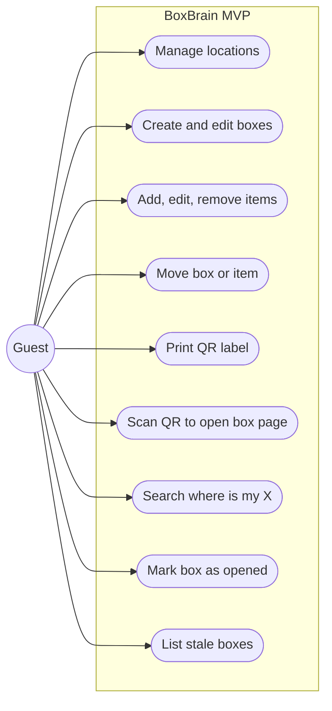
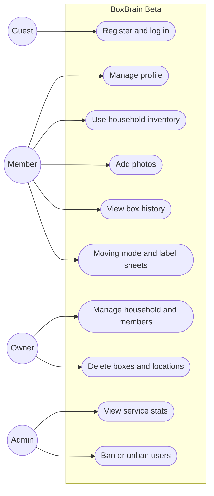
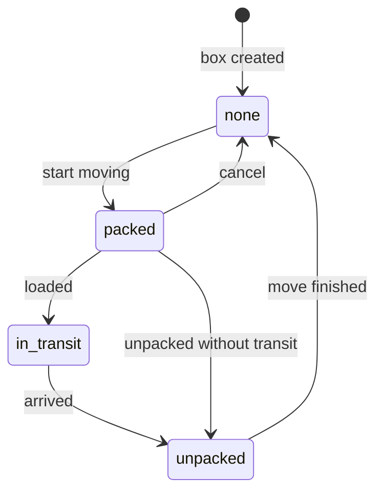

# Software Requirements Specification (SRS): BoxBrain

| | |
|---|---|
| **Product** | BoxBrain |
| **Document** | Software Requirements Specification (SRS) |
| **Version** | 1.0 |
| **Date** | October 2026 |
| **Author** | Rifat |
| **Related docs** | [PRD](01-prd.md) · [TDD](03-tdd.md) |

---

## 1. Introduction

### 1.1 Purpose

This document lists what BoxBrain must do (functional requirements) and how well it must do it (non-functional requirements). It is the reference for building and checking the system. Every requirement has an ID, a release (MVP or Beta) and a link back to a user story in the [PRD](01-prd.md).

### 1.2 Scope

BoxBrain is a web app that stores the contents and locations of physical containers and links each one to a QR label. The MVP covers locations, boxes, items, QR labels, scanning, search and the "not opened since" filter, with one shared inventory and no accounts. Beta adds accounts, private households with roles, photos, box history, moving mode, label sheets, fuzzy search and admin tools. Out of scope: automated tests, CI/CD, native apps, an in-app scanner, offline mode, product barcodes and notifications.

### 1.3 Definitions

| Term | Meaning |
|---|---|
| **CRUD** | Create, Read, Update, Delete. |
| **REST** | An API style where resources are reached by URL and HTTP methods (`GET`, `POST`, `PATCH`, `DELETE`). |
| **JWT** | JSON Web Token. A signed token that proves who the user is. |
| **Refresh token** | A long-lived token used to get a new access token without logging in again. |
| **RBAC** | Role-based access control. What a user can do depends on their role. |
| **Location** | A place where boxes are kept. Locations can sit inside other locations (Bedroom → Cupboard → Top shelf). |
| **Location path** | The full chain from the top location down, for example `Bedroom → Cupboard → Top shelf`. |
| **Box** | Any physical container: cardboard box, suitcase, plastic container, drawer, cupboard, bag. Each has a number and a QR token. |
| **Item** | A thing stored inside a box, with a name and quantity. |
| **QR token** | A random string stored on a box and encoded in its QR code as a link (`/b/<token>`). |
| **Opened** | The last time someone opened the box, set by "mark as opened" or by changing its items. |
| **Stale box** | A box not opened since a chosen date (default: 12 months ago). |
| **Household** | A private inventory shared by a group of users (Beta). |
| **Moving mode** | Extra box statuses for moving house: `packed`, `in_transit`, `unpacked` (Beta). |

### 1.4 Roles

| Role | Type | Release | Description |
|---|---|---|---|
| `guest` | Global | MVP, Beta | Not logged in. In the MVP everyone is a guest and uses one shared demo inventory. |
| `user` | Global | Beta | Logged-in account. |
| `admin` | Global | Beta | Can see service-wide stats and ban users. **Cannot** see the contents of other people's households. |
| `owner` | Per household | Beta | Created the household. Manages members, renames or deletes the household, and can delete boxes and locations. |
| `member` | Per household | Beta | Invited into a household. Can view and edit boxes, items and locations, but cannot delete boxes or locations or manage members. |

## 2. Overall description

### 2.1 Use cases, MVP

### 2.2 Use cases, Beta

An owner can also do everything a member can. Any logged-in user can create their own household and become its owner.

### 2.3 Box move status (Beta)

| Status | Meaning |
|---|---|
| `none` | Normal storage, not part of a move. |
| `packed` | Packed and labelled, waiting to be moved. |
| `in_transit` | On the way to the new place. |
| `unpacked` | Arrived and unpacked. Its location can be set to the destination in one step. |

## 3. Functional requirements

### 3.1 MVP

| ID | Requirement | Release | Story |
|---|---|---|---|
| FR-01 | The user shall be able to create a location with a name and an optional parent location, up to 5 levels deep. | MVP | US-01 |
| FR-02 | The user shall be able to rename a location or move it under another parent. The system shall reject moves that create a cycle. | MVP | US-01 |
| FR-03 | The system shall list all locations as a tree, each with its full location path and box count. | MVP | US-01, US-11 |
| FR-04 | The user shall be able to create a box with a number, label, type, location and notes. If no number is given, the system assigns the next free number. | MVP | US-02 |
| FR-05 | On creation, the system shall give each box a unique random QR token and set its last opened time to the creation time. | MVP | US-02, US-04 |
| FR-06 | The system shall return a box with its items, location path and last opened time. | MVP | US-03, US-05 |
| FR-07 | The user shall be able to edit a box's number, label, type, notes and location. Changing the location moves the box. | MVP | US-02, US-07 |
| FR-08 | The user shall be able to add, edit and remove items in a box, each with name, quantity and notes. Any item change updates the box's last opened time. | MVP | US-03 |
| FR-09 | The user shall be able to move an item to another box. | MVP | US-08 |
| FR-10 | The system shall generate a QR code (SVG) for each box that encodes `APP_BASE_URL/b/<qr_token>`, and the UI shall show a printable label with the QR code, box number and label. | MVP | US-04 |
| FR-11 | Opening `/b/<qr_token>` shall show that box's page. An unknown token shows a "box not found" page. | MVP | US-05 |
| FR-12 | The system shall search item names and notes, box labels and box notes, and return each match with its box number, box label and location path, best matches first. | MVP | US-06 |
| FR-13 | The user shall be able to mark a box as opened, which sets its last opened time to now. | MVP | US-09 |
| FR-14 | The system shall list boxes not opened since a given date. The UI offers 3, 6, 12 and 24 months, with 12 as the default. | MVP | US-10 |
| FR-15 | The system shall list boxes with filters for location (optionally including sub-locations), type and text, with sorting and pagination. | MVP | US-11 |
| FR-16 | The user shall be able to delete a box (its items are deleted too) and delete an empty location. Deleting a location that still has boxes or sub-locations is rejected. | MVP | US-12 |
| FR-17 | The system shall provide a seed script that creates sample locations, boxes and items for the demo. | MVP | US-06, US-10 |

### 3.2 Beta

| ID | Requirement | Release | Story |
|---|---|---|---|
| FR-18 | A guest shall be able to register with name, email and password. On sign-up the user gets a personal household and becomes its owner. | Beta | US-13 |
| FR-19 | A user shall be able to log in and receive an access token and a refresh token. | Beta | US-14 |
| FR-20 | A user shall be able to get a new token pair with a valid refresh token; the old refresh token is revoked (rotation). | Beta | US-14 |
| FR-21 | A user shall be able to log out, which revokes their refresh token. | Beta | US-14 |
| FR-22 | A user shall be able to view their profile, change their name, and change their password by giving the current one. Changing the password revokes all refresh tokens. | Beta | US-15 |
| FR-23 | A user shall be able to create more households and list the households they belong to. | Beta | US-16 |
| FR-24 | A household owner shall be able to add a registered user by email as a `member` (at most 10 members per household). | Beta | US-16 |
| FR-25 | An owner shall be able to remove a member, and a member shall be able to leave a household. The owner cannot leave without deleting the household. | Beta | US-17 |
| FR-26 | Every location, box and item shall belong to a household. Users shall only see and change data in households they belong to. | Beta | US-16 |
| FR-27 | QR links shall only show a box to logged-in members of its household. Others see the login page or "box not found". | Beta | US-14, US-16 |
| FR-28 | A member shall be able to upload one photo for a box and one for an item (JPEG, PNG or WebP, max 2 MB). | Beta | US-18 |
| FR-29 | The system shall record box events (created, opened, moved, edited, item added, item removed, item moved, move status changed) with the user and time, and show them on the box page. | Beta | US-19 |
| FR-30 | A member shall be able to set a box's move status (`none`, `packed`, `in_transit`, `unpacked`) and a destination location. When set to `unpacked`, the user can move the box to its destination in one step. | Beta | US-20 |
| FR-31 | The system shall show a moving summary for a household: number of boxes per move status. | Beta | US-20 |
| FR-32 | The user shall be able to select several boxes and print a label sheet with up to 21 QR labels per A4 page. | Beta | US-21 |
| FR-33 | Search shall also return close matches for small typos (fuzzy search), ranked below exact and partial matches. | Beta | US-22 |
| FR-34 | An admin shall be able to view service stats: users (total, banned, new in the last 7 days), households, boxes, items and boxes created per week. Stats never include box or item contents. | Beta | US-23 |
| FR-35 | An admin shall be able to list users and ban or unban them. A banned user cannot log in or refresh tokens. | Beta | US-24 |
| FR-36 | The system shall enforce the permission matrix in section 6 on every Beta endpoint. | Beta | US-16, US-17, US-23, US-24 |

## 4. Non-functional requirements

| ID | Category | Requirement | Release |
|---|---|---|---|
| NFR-01 | Performance | Search responds in under 500 ms (p95) for an inventory of up to 5,000 items, not counting serverless cold starts. | MVP |
| NFR-02 | Performance | The box page opened from a QR scan loads in under 2 seconds on a phone with a normal connection. | MVP |
| NFR-03 | Usability | The UI is mobile-first and works from 360 px wide screens up to desktop. | MVP |
| NFR-04 | Usability | Creating a box with 5 items takes under 2 minutes for a first-time user. | MVP |
| NFR-05 | Usability | A printed QR label about 3 cm wide scans with a normal phone camera. The box number is printed in large text so the box can be identified even if the QR is damaged. | MVP |
| NFR-06 | Security | QR tokens are random (at least 60 bits) so box links can't be guessed by counting. | MVP |
| NFR-07 | Security | All traffic is served over HTTPS. | MVP |
| NFR-08 | Security | Secrets (database URL, JWT secret, storage keys) are stored in environment variables and never committed to Git. | MVP |
| NFR-09 | Security | All input is validated on the server; invalid input returns `422`. | MVP |
| NFR-10 | Privacy | The MVP shows a banner that the inventory is a shared demo, and the demo uses sample data only. | MVP |
| NFR-11 | Maintainability | Backend code is split into routers, services, models and schemas. OpenAPI docs are served at `/api/docs`. | MVP |
| NFR-12 | Security | Passwords are hashed with Argon2id. | Beta |
| NFR-13 | Security | Access tokens expire after 15 minutes; refresh tokens after 7 days and are rotated on use. | Beta |
| NFR-14 | Security | After 5 failed logins an account is locked for 15 minutes. | Beta |
| NFR-15 | Security | Write requests are limited to 300 per hour per user, and photo uploads to 30 per hour per user. | Beta |
| NFR-16 | Security | CORS allows only the frontend origin. Responses include basic security headers (`X-Content-Type-Options`, `X-Frame-Options`, `Referrer-Policy`). | Beta |
| NFR-17 | Privacy | Requests for boxes, items or locations outside the user's households return `404`, so the API doesn't reveal that they exist. | Beta |
| NFR-18 | Privacy | Photos are stored in a private bucket and shown through signed URLs that expire after 1 hour. | Beta |
| NFR-19 | Maintainability | Database schema changes are made through Alembic migrations. | Beta |

## 5. Validation rules

| Field | Rule | Release |
|---|---|---|
| Location `name` | 1 to 60 characters, unique among locations with the same parent (case-insensitive) | MVP |
| Location `parent_id` | Must exist; resulting depth at most 5; cannot be the location itself or one of its sub-locations | MVP |
| Box `number` | Whole number from 1 to 99999, unique (per household in Beta). Optional on create. | MVP |
| Box `label` | 1 to 60 characters | MVP |
| Box `type` | One of `cardboard_box`, `suitcase`, `plastic_container`, `drawer`, `cupboard`, `bag`, `other` | MVP |
| Box `location_id` | Required, must exist | MVP |
| Box `notes` | Up to 500 characters | MVP |
| Item `name` | 1 to 80 characters | MVP |
| Item `quantity` | Whole number from 1 to 9999, default 1 | MVP |
| Item `notes` | Up to 300 characters | MVP |
| Item `box_id` (when moving) | Must exist (and be in the same household in Beta) | MVP |
| Search `q` | 2 to 60 characters | MVP |
| `not_opened_since` | A date, not in the future | MVP |
| `email` | Valid email address, stored in lowercase | Beta |
| `password` | At least 8 characters with at least one letter and one digit | Beta |
| User `name`, household `name` | 2 to 60 characters | Beta |
| Photo | JPEG, PNG or WebP, at most 2 MB | Beta |
| `move_status` | One of `none`, `packed`, `in_transit`, `unpacked` | Beta |
| `destination_location_id` | Optional; must be a location in the same household | Beta |
| Add member `email` | Must belong to a registered, non-banned user who isn't already a member | Beta |
| Label sheet `box_ids` | 1 to 63 box IDs (3 pages), all in the same household | Beta |

## 6. Beta permission matrix

✅ allowed · ❌ not allowed. Household rows apply only inside households the user belongs to.

| Action | Guest | Member | Owner | Admin (outside own households) |
|---|---|---|---|---|
| Register / log in | ✅ | – | – | – |
| View and edit own profile | ❌ | ✅ | ✅ | ✅ |
| Create a new household | ❌ | ✅ | ✅ | ✅ |
| View locations, boxes, items, search | ❌ | ✅ | ✅ | ❌ |
| Open a box from its QR link | ❌ | ✅ | ✅ | ❌ |
| Create and edit locations, boxes, items | ❌ | ✅ | ✅ | ❌ |
| Move boxes and items, mark opened | ❌ | ✅ | ✅ | ❌ |
| Upload photos | ❌ | ✅ | ✅ | ❌ |
| Set move status, print label sheets | ❌ | ✅ | ✅ | ❌ |
| View box history | ❌ | ✅ | ✅ | ❌ |
| Delete boxes and locations | ❌ | ❌ | ✅ | ❌ |
| Rename or delete household | ❌ | ❌ | ✅ | ❌ |
| Add or remove members | ❌ | ❌ | ✅ | ❌ |
| Leave household | ❌ | ✅ | ❌ | ❌ |
| View service stats | ❌ | ❌ | ❌ | ✅ |
| List, ban, unban users | ❌ | ❌ | ❌ | ✅ |

An admin uses their own households like any other user. Being an admin gives no access to other people's inventories.

## 7. Status codes

| Code | When |
|---|---|
| `200 OK` | Successful read or update |
| `201 Created` | Location, box, item, user, household or member created |
| `204 No Content` | Successful delete, logout or leave |
| `400 Bad Request` | Request breaks a rule (for example moving a location into its own sub-location, or deeper than 5 levels) |
| `401 Unauthorized` | Missing or invalid token (Beta) |
| `403 Forbidden` | Member trying an owner-only action, non-admin calling an admin endpoint, or banned user |
| `404 Not Found` | Resource doesn't exist, or (Beta) belongs to a household the user isn't in |
| `409 Conflict` | Duplicate box number or location name, deleting a location that isn't empty, email already registered, user already a member |
| `413 Payload Too Large` | Photo larger than 2 MB |
| `422 Unprocessable Entity` | Validation failed |
| `429 Too Many Requests` | Rate limit hit or account locked after failed logins |
| `500 Internal Server Error` | Unexpected server error |

## 8. Acceptance criteria

| ID | Given | When | Then | Covers |
|---|---|---|---|---|
| AC-01 | Location "Bedroom" exists | The user creates "Cupboard" inside it and "Top shelf" inside that | All three exist and "Top shelf" has the path `Bedroom → Cupboard → Top shelf` | FR-01, FR-03 |
| AC-02 | "Cupboard" is inside "Bedroom" | The user tries to move "Bedroom" inside "Cupboard" | `400` is returned and nothing changes | FR-02 |
| AC-03 | Boxes 1 to 16 exist | The user creates a box without a number | The box gets number 17, a QR token and a last opened time equal to now | FR-04, FR-05 |
| AC-04 | Box 17 exists | The user creates another box with number 17 | `409` is returned | FR-04 |
| AC-05 | Box 17 has a QR label | Someone scans it with a phone camera | The phone opens `/b/<token>` and shows box 17 with its items and location path | FR-10, FR-11 |
| AC-06 | Box 4 "Documents" in `Bedroom → Cupboard → Top shelf` contains "Passport" | The user searches `passport` | The first result is "Passport" in box 4 with that location path | FR-12 |
| AC-07 | Box 17 is in "Storage room" | The user changes its location to "Garage" | Box 17's path is now "Garage", and searching its items shows the new path | FR-07, FR-12 |
| AC-08 | "Gloves" is in box 17 | The user moves it to box 20 | Box 17 no longer lists gloves, box 20 does, and both boxes' last opened times are updated | FR-08, FR-09 |
| AC-09 | Box 9 was last opened 14 months ago and box 10 last week | The user lists boxes not opened for 12 months | Box 9 is listed and box 10 isn't | FR-14 |
| AC-10 | Box 9 is stale | The user marks it as opened | Box 9 no longer appears in the 12-month stale list | FR-13, FR-14 |
| AC-11 | "Garage" contains one box | The user tries to delete "Garage" | `409` is returned and the location stays | FR-16 |
| AC-12 | A guest is on the register page | They sign up with valid details | An account and a personal household are created, and the user is its owner | FR-18 |
| AC-13 | A user has a valid refresh token | They call refresh | A new token pair is returned and the old refresh token no longer works | FR-20 |
| AC-14 | A user fails login 5 times | They try again with the right password | `429` is returned until 15 minutes have passed | FR-19, NFR-14 |
| AC-15 | User A's household has box 3 | User B, who isn't a member, opens box 3's QR link or calls its endpoint | B gets "box not found" (`404`) | FR-26, FR-27, NFR-17 |
| AC-16 | A member is in a household | They try to delete a box | `403` is returned | FR-36 |
| AC-17 | An owner adds a registered user's email | The request succeeds | That user now sees the household's boxes | FR-24, FR-26 |
| AC-18 | 12 boxes are `packed` | The user marks 5 as `unpacked` | The moving summary shows 7 packed and 5 unpacked, and each box's history has a "move status changed" event | FR-29, FR-30, FR-31 |
| AC-19 | The user selects 25 boxes | They open the label sheet | Two A4 pages are shown (21 + 4 labels), each label with QR, number and label | FR-32 |
| AC-20 | An item "Passport" exists | The user searches `pasport` | "Passport" appears in the results | FR-33 |
| AC-21 | A logged-in `user` (not admin) | They call an `/admin` endpoint | `403` is returned | FR-36 |
| AC-22 | An admin bans a user | That user tries to log in | `403` is returned | FR-35 |

## 9. Traceability

| Story | Requirements | Endpoint(s) |
|---|---|---|
| US-01 | FR-01, FR-02, FR-03 | `GET /api/v1/locations`, `POST /api/v1/locations`, `PATCH /api/v1/locations/{id}` |
| US-02 | FR-04, FR-05, FR-07 | `POST /api/v1/boxes`, `PATCH /api/v1/boxes/{id}` |
| US-03 | FR-06, FR-08 | `GET /api/v1/boxes/{id}`, `POST /api/v1/boxes/{id}/items`, `PATCH /api/v1/items/{id}`, `DELETE /api/v1/items/{id}` |
| US-04 | FR-05, FR-10 | `GET /api/v1/boxes/{id}/qr.svg` |
| US-05 | FR-06, FR-11 | `GET /api/v1/boxes/by-qr/{qr_token}` |
| US-06 | FR-12, FR-17 | `GET /api/v1/search` |
| US-07 | FR-07 | `PATCH /api/v1/boxes/{id}` |
| US-08 | FR-09 | `PATCH /api/v1/items/{id}` |
| US-09 | FR-13 | `POST /api/v1/boxes/{id}/opened` |
| US-10 | FR-14, FR-17 | `GET /api/v1/boxes?not_opened_since=` |
| US-11 | FR-03, FR-15 | `GET /api/v1/boxes`, `GET /api/v1/locations/{id}` |
| US-12 | FR-16 | `DELETE /api/v1/boxes/{id}`, `DELETE /api/v1/locations/{id}` |
| US-13 | FR-18 | `POST /api/v1/auth/register` |
| US-14 | FR-19, FR-20, FR-21, FR-27 | `POST /api/v1/auth/login`, `POST /api/v1/auth/refresh`, `POST /api/v1/auth/logout` |
| US-15 | FR-22 | `GET /api/v1/users/me`, `PATCH /api/v1/users/me`, `POST /api/v1/users/me/password` |
| US-16 | FR-23, FR-24, FR-26, FR-36 | `GET /api/v1/households`, `POST /api/v1/households`, `POST /api/v1/households/{id}/members` |
| US-17 | FR-25, FR-36 | `DELETE /api/v1/households/{id}/members/{user_id}` |
| US-18 | FR-28 | `POST /api/v1/boxes/{id}/photo`, `POST /api/v1/items/{id}/photo` |
| US-19 | FR-29 | `GET /api/v1/boxes/{id}/events` |
| US-20 | FR-30, FR-31 | `PATCH /api/v1/boxes/{id}/move-status`, `GET /api/v1/households/{id}/moving-summary` |
| US-21 | FR-32 | `GET /api/v1/boxes/labels?ids=` |
| US-22 | FR-33 | `GET /api/v1/search` |
| US-23 | FR-34, FR-36 | `GET /api/v1/admin/stats` |
| US-24 | FR-35, FR-36 | `GET /api/v1/admin/users`, `POST /api/v1/admin/users/{id}/ban`, `POST /api/v1/admin/users/{id}/unban` |
