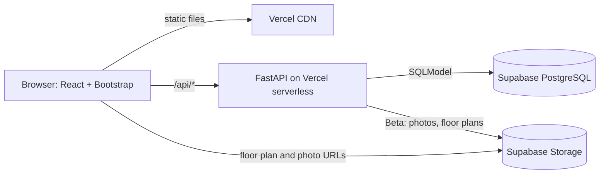
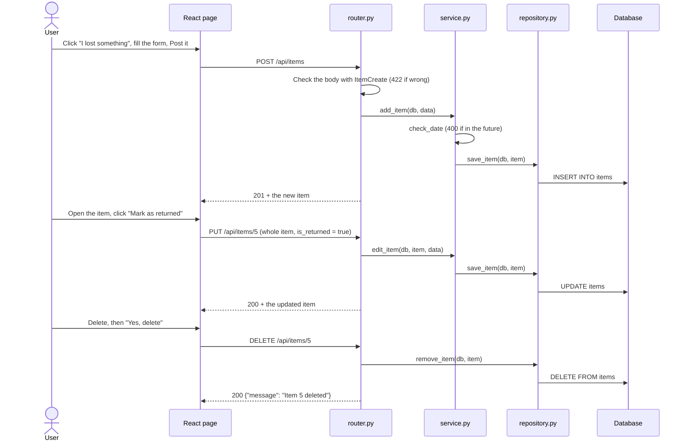
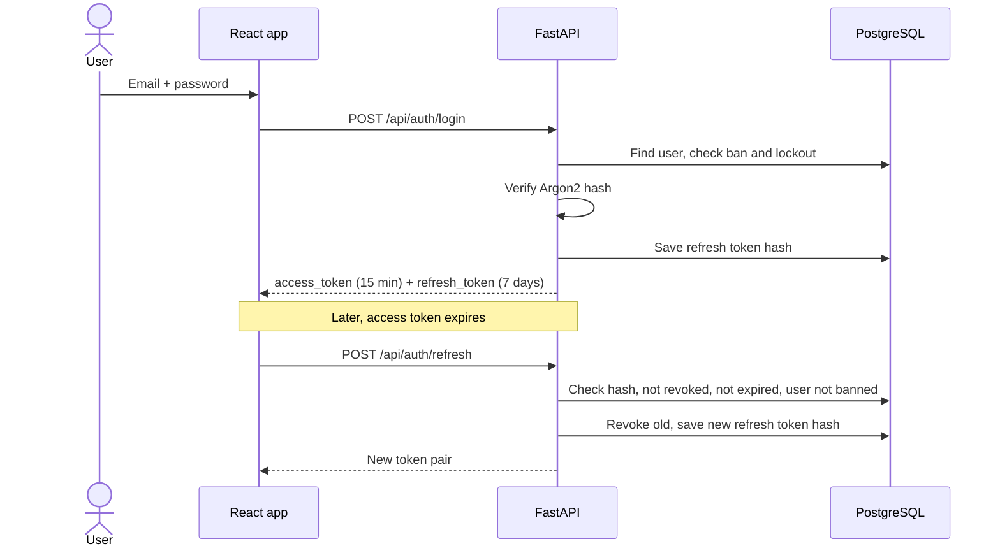
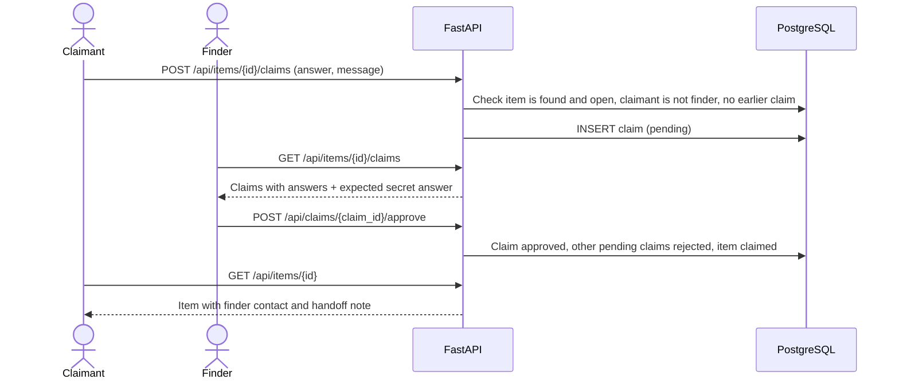
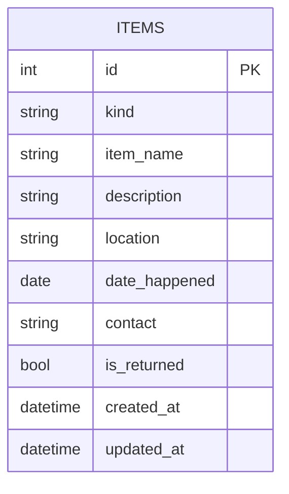
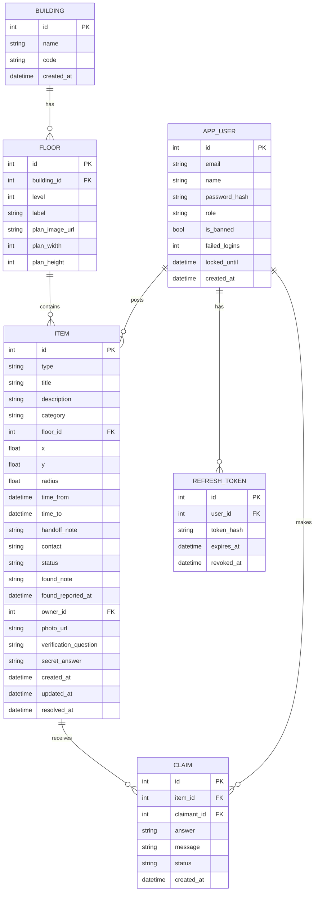

# Technical Design Document (TDD): LostSpot

| | |
|---|---|
| **Product** | LostSpot |
| **Document** | Technical Design Document (TDD) |
| **Version** | 1.2 |
| **Date** | 6 November 2026 |
| **Author** | Rifat |
| **Related docs** | [PRD](01-prd.md) · [SRS](02-srs.md) |

---

## 1. Overview

This document explains how LostSpot is built: the stack, the architecture, the data model, the REST API and the security design. Sections marked MVP describe what is built in `v0.1.0`; the floor map, matching logic and everything marked Beta come next. Requirement IDs (FR-xx, NFR-xx) refer to the [SRS](02-srs.md).

## 2. Tech stack

| Layer | Choice | Release | Why |
|---|---|---|---|
| Backend | FastAPI (Python) | MVP | Fast to write, automatic OpenAPI docs, Pydantic validation |
| ORM | SQLModel | MVP | One class for both the table and the schema |
| Database | Supabase PostgreSQL (production), SQLite (local) | MVP | Free hosted Postgres; SQLite needs no setup locally |
| Frontend | React + TypeScript + Vite | MVP | Fast dev server, typed API calls |
| UI library | Bootstrap 5 with React-Bootstrap, plus my own CSS (sidebar layout, Poppins font, teal theme) | MVP | Ready-made forms, slide-in panel (Offcanvas), confirm dialog and alerts; widely taught |
| Routing | React Router | MVP | One page per URL (`/` and `/items/:id`) |
| Floor map | Leaflet (`react-leaflet`) with `CRS.Simple` and an image overlay | Beta | Treats a floor plan image as a flat map with zoom, pins and circles |
| Hosting | Vercel (static frontend + Python serverless function for `/api/*`) | MVP | Free, deploys from GitHub |
| Migrations | Alembic | Beta | Safe schema changes once real data exists |
| Auth | PyJWT (access + refresh tokens) | Beta | Simple, stateless access tokens |
| Password hashing | Argon2 (`argon2-cffi`) | Beta | Current recommended password hash |
| File storage | Supabase Storage | Beta | Item photos and floor plan uploads |

## 3. Architecture



Vercel serves the React build as static files. Every request to `/api/*` is routed by `vercel.json` to the FastAPI app (`backend/main.py`), which runs as a serverless function. The app talks to Supabase PostgreSQL in production and to a SQLite file locally. In Beta, floor plan images and item photos live in Supabase Storage.

### 3.1 Request flow

1. A page calls a function in `frontend/src/api/items.ts`, for example `getItems("all", "")`, which sends `GET /api/items`.
2. Vercel sends every `/api/*` request to the `backend` service (`backend/main.py`), as set in `vercel.json`. Locally, Vite forwards `/api` to `localhost:8000`.
3. FastAPI checks the request against the schemas in `app/items/schemas.py` and answers `422` if something is wrong.
4. For routes with an id in the URL, `get_item_or_404` (in `app/items/dependencies.py`) loads the item first, or answers `404`.
5. The route in `app/items/router.py` calls a function in `app/items/service.py`, which checks the rules (the date can't be in the future, `400`).
6. The service calls `app/items/repository.py`, the only file that runs database queries, on the `items` table.
7. The item is sent back as JSON (`ItemResponse`). The page puts it into its state with `useState`, and React redraws the screen.

### 3.2 Create, update and delete an item (MVP)



### 3.3 Login and refresh (Beta)



### 3.4 Claim a found item (Beta)



## 4. Project structure

```
lostspot/
├── backend/
│   ├── main.py                 # Creates the FastAPI app, adds the item routes, creates the tables
│   ├── requirements.txt
│   └── app/
│       ├── config.py           # Picks the database: DATABASE_URL (Supabase) or a local SQLite file
│       ├── database.py         # The engine, create_tables() and get_db() (one session per request)
│       └── items/
│           ├── models.py       # The `items` table
│           ├── schemas.py      # ItemCreate, ItemUpdate, ItemResponse (what the API accepts and returns)
│           ├── repository.py   # Database queries: find_items, find_item_by_id, save_item, remove_item
│           ├── service.py      # Rules: check_date, add_item, edit_item, delete_item
│           ├── dependencies.py # get_item_or_404: loads the item for routes with {item_id}
│           └── router.py       # The five routes under /api/items
├── frontend/
│   └── src/
│       ├── main.tsx            # Starts React, loads Bootstrap's CSS, turns on the router
│       ├── App.tsx             # Picks the page for the URL
│       ├── api/items.ts        # One function per API call (getItems, getItem, createItem, updateItem, deleteItem)
│       ├── types.ts            # Item and ItemFormData types
│       ├── utils.ts            # Dates and form helpers
│       ├── components/         # Sidebar, ItemRow, ItemFormDrawer (slide-in form)
│       └── pages/              # HomePage (list, filters, search), ItemPage (details, edit, returned, delete)
├── docs/                       # PRD, SRS, TDD
└── vercel.json                 # /api/* -> backend, everything else -> frontend
```

## 5. Data model

### 5.0 MVP: the `items` table (built in `v0.1.0`)

The MVP has one table and no relationships yet.



| Column | Type | Rules |
|---|---|---|
| `id` | integer, primary key | The database numbers rows automatically: 1, 2, 3... |
| `kind` | text (5) | `lost` or `found` |
| `item_name` | text (100) | Required, spaces trimmed |
| `description` | text (500), can be empty | Optional |
| `location` | text (150) | Required, e.g. "CSE Building, Floor 2, near Lab 1" |
| `date_happened` | date | The day it was lost or found; not in the future |
| `contact` | text (100), can be empty | Optional, shown publicly |
| `is_returned` | true / false | `false` when created |
| `created_at`, `updated_at` | date and time (UTC) | Set by the backend; `updated_at` changes on every update |

### 5.1 Beta ERD

In Beta the free-text `location` is joined by a place on a floor plan, and items get owners and claims:



### 5.2 Tables

**Beta (floor maps)**

- `building`: campus buildings. `code` is short and unique (for example `CSE`).
- `floor`: one row per floor. `plan_width` and `plan_height` are the image size in pixels, used to convert relative coordinates.
- `item`: lost and found posts. `radius` and `time_to` are set only for lost items; `handoff_note` only for found items. `found_note` and `found_reported_at` are filled by a found report. Indexes on `(floor_id, status)`, `(category, status)` and `created_at`. `is_returned` becomes the `status` column.

**Beta (accounts and claims)**

- `item.owner_id`, `item.photo_url`, `item.verification_question`, `item.secret_answer`. 
- `app_user`: `role` is `user` or `admin`. `email` is unique and stored in lowercase.
- `refresh_token`: stores only a SHA-256 hash of each refresh token.
- `claim`: `status` is `pending`, `approved` or `rejected`. Unique on `(item_id, claimant_id)`.

Match suggestions are calculated on request, so there is no match table.

## 6. Floor map design (Beta)

- Each floor has one plan image. The map uses Leaflet's `CRS.Simple`, with the image placed as an `ImageOverlay` covering bounds `[[0, 0], [plan_height, plan_width]]`.
- Positions are stored **relative to the image**: `x` and `y` from 0 to 1 (`x` from the left, `y` from the top). The frontend converts them to map coordinates with `lat = (1 - y) * plan_height` and `lng = x * plan_width`. Because they are relative, replacing an image with a higher-resolution version doesn't break existing pins.
- `radius` is relative to `plan_width` (0.1 means a circle whose radius is 10% of the image width).
- Found items are drawn as pins with a category icon. Lost items are drawn as semi-transparent circles. Clicking either opens a small card with a link to the item page.
- To post, the user taps the map: for a found item this places the pin; for a lost item it places the centre, and a slider sets the radius.
- MVP floor plans are simple images drawn by the team (for example one PNG per floor of the CS building), stored in `frontend/public/floors/`.

## 7. Matching logic (Beta)

For a lost item `L`, a found item `F` is a match when all of these hold:

1. `F.type = found`, `F.status = open`, `F.floor_id = L.floor_id`, `F.category = L.category`.
2. `L.time_from ≤ F.time_from ≤ L.time_to + 48 hours`.
3. The pin is inside the lost area, using pixel distance so that non-square images work:

```
dx = (F.x - L.x) * plan_width
dy = (F.y - L.y) * plan_height
distance = sqrt(dx² + dy²)
match if distance ≤ L.radius * plan_width
```

Steps 1 and 2 run as a SQL filter. Step 3 runs in Python on the (small) filtered list. Results are sorted by distance and limited to 10. The same function run the other way gives "lost items that may belong to this found item".

## 8. REST API

All endpoints are under `/api`. OpenAPI docs are at `/api/docs` (not `/docs`, because `vercel.json` sends only `/api/*` to the backend). Errors use FastAPI's default shape `{"detail": "..."}`.

### 8.1 MVP endpoints

There are no accounts in the MVP, so anyone can call these.

| Method | Path | What it does | Success | Errors |
|---|---|---|---|---|
| `GET` | `/api/items` | **Read list**, newest first. Optional `?kind=lost` or `found`, and `?search=word` | `200` + list of items | `422` bad `kind` |
| `POST` | `/api/items` | **Create** an item | `201` + the item | `422` invalid input, `400` date in the future |
| `GET` | `/api/items/{id}` | **Read one** item | `200` + the item | `404` "No item with id N" |
| `PUT` | `/api/items/{id}` | **Update**: send the whole item, including `is_returned` | `200` + the item | `404`, `422`, `400` |
| `DELETE` | `/api/items/{id}` | **Delete** an item | `200` + `{"message": "Item N deleted"}` | `404` |
| `GET` | `/api/health` | Check the backend is running | `200` | |

Create example:

```json
POST /api/items
{
  "kind": "lost",
  "item_name": "Black car key",
  "location": "CSE Building, Floor 2, near Lab 1",
  "date_happened": "2026-11-06",
  "description": "Toyota key with a red keychain",
  "contact": "2311188@iub.edu.bd"
}
```

Answer `201`:

```json
{
  "id": 5,
  "kind": "lost",
  "item_name": "Black car key",
  "description": "Toyota key with a red keychain",
  "location": "CSE Building, Floor 2, near Lab 1",
  "date_happened": "2026-11-06",
  "contact": "2311188@iub.edu.bd",
  "is_returned": false,
  "created_at": "2026-11-06T07:17:59.561502Z",
  "updated_at": "2026-11-06T07:17:59.561502Z"
}
```

Update uses `PUT`, so the frontend sends every field (it already has them all in the edit form). To mark the item returned, it sends the same item with `"is_returned": true`.

### 8.2 Beta endpoints

From Beta on, item endpoints need a logged-in user. "Owner" means the user who created that item.

| Method | Path | Who can call | Description |
|---|---|---|---|
| `POST` | `/auth/register` | Guest | Create account (allowed email domains only) |
| `POST` | `/auth/login` | Guest | Get access and refresh tokens |
| `POST` | `/auth/refresh` | Holder of refresh token | Rotate tokens |
| `POST` | `/auth/logout` | User | Revoke refresh token |
| `GET` | `/users/me` | User | Own profile |
| `PATCH` | `/users/me` | User | Change name |
| `POST` | `/users/me/password` | User | Change password |
| `GET` | `/users/me/items` | User | Own items |
| `POST` | `/items` | User | Create item (optional `verification_question`, `secret_answer` for found items) |
| `PATCH` | `/items/{id}` | Owner, admin | Update item |
| `DELETE` | `/items/{id}` | Owner, admin | Delete item |
| `POST` | `/items/{id}/resolve` | Owner, admin | Mark resolved |
| `POST` | `/items/{id}/reopen` | Owner, admin | Back to `open` |
| `POST` | `/items/{id}/found-report` | User (not owner) | Report lost item as found |
| `POST` | `/items/{id}/photo` | Owner, admin | Upload photo (multipart) |
| `GET` | `/items/{id}/matches` | Owner, admin | Match suggestions |
| `POST` | `/items/{id}/claims` | User (not owner) | Claim a found item |
| `GET` | `/items/{id}/claims` | Owner, admin | List claims with answers |
| `POST` | `/claims/{id}/approve` | Item owner, admin | Approve claim |
| `POST` | `/claims/{id}/reject` | Item owner, admin | Reject claim |
| `GET` | `/admin/stats` | Admin | Dashboard stats |
| `DELETE` | `/admin/items/{id}` | Admin | Remove item (status `removed`) |
| `GET` | `/admin/users` | Admin | List users |
| `POST` | `/admin/users/{id}/ban` | Admin | Ban user and revoke their refresh tokens |
| `POST` | `/admin/users/{id}/unban` | Admin | Unban user |
| `POST` | `/admin/buildings` | Admin | Create building |
| `POST` | `/admin/buildings/{id}/floors` | Admin | Add floor with plan image |

## 9. Security design

### 9.1 MVP

- No accounts yet: anyone can create, edit and delete items. This is accepted for the mid-term demo; Beta adds login and ownership checks.
- Every request body is checked by the schemas before any of our code runs (`422`).
- Update and delete first load the item with `get_item_or_404`, so a missing id always gives a clean `404`.
- The database URL comes from an environment variable and is never committed.

### 9.2 Authentication (Beta)

- Passwords hashed with Argon2id (`argon2-cffi` defaults).
- Access token: JWT signed with HS256 using `JWT_SECRET`, claims `sub` (user id), `role`, `exp` (15 minutes). Sent as `Authorization: Bearer <token>`.
- Refresh token: random string, 7 days. Only its SHA-256 hash is stored. Each refresh revokes the old token and issues a new one. If a revoked token is used again, all of that user's refresh tokens are revoked.
- Login lockout: `failed_logins` increases on each wrong password. At 5, `locked_until = now + 15 min` and login returns `429`. A successful login resets the counter.
- Changing a password or being banned revokes all refresh tokens.

### 9.3 Authorisation (Beta)

FastAPI dependencies keep the checks in one place:

- `get_current_user`: decodes the JWT, loads the user, rejects banned users with `403`.
- `get_optional_user`: same, but returns `None` for guests (used to hide contact details).
- `require_admin`: `403` unless `role = admin`.
- `get_owned_item`: loads the item and allows only its owner or an admin.

### 9.4 Claim verification (Beta)

The secret answer is stored as plain text because the finder has to compare it with free-text answers by eye ("red keychain" vs "it has a red key ring"). It is never included in responses except to the finder and admins. Each user can claim an item only once, and claims are rate limited (NFR-14), so guessing is not practical.

### 9.5 Other measures

- Pydantic validation on every input (SRS section 5).
- Response schemas leave out `secret_answer` and, for guests in Beta, `contact`.
- CORS limited to `FRONTEND_ORIGIN` (Beta).
- Security headers added by a small middleware (Beta).
- Rate limiting with a simple per-user / per-IP counter table, since serverless functions don't share memory (Beta).
- Photo uploads: check content type and size (2 MB), rename to a random file name, store in a public-read bucket.

## 10. Admin dashboard stats (Beta)

`GET /api/admin/stats` returns:

```json
{
  "items_by_type_status": { "lost": { "open": 12, "found_reported": 3, "resolved": 20 }, "found": { "open": 8, "claimed": 2, "resolved": 15 } },
  "resolution_rate": 0.58,
  "items_per_building": [ { "building": "CSE", "count": 41 } ],
  "items_last_7_days": 9,
  "avg_hours_to_resolve": 19.5,
  "users": { "total": 64, "banned": 1 }
}
```

Each number comes from one `GROUP BY` query. With a few thousand rows this is fast enough without caching.

## 11. Configuration

| Variable | Release | Description |
|---|---|---|
| `DATABASE_URL` | MVP | Supabase transaction pooler URL in production. Unset locally, which uses `backend/lostspot.db` (SQLite). |
| `POSTGRES_URL` | MVP | Added by Vercel's Supabase integration; used when `DATABASE_URL` is unset |
| `FRONTEND_ORIGIN` | Beta | Frontend URL, used for CORS |
| `JWT_SECRET` | Beta | Long random secret for signing tokens |
| `ACCESS_TOKEN_MINUTES` | Beta | Default `15` |
| `REFRESH_TOKEN_DAYS` | Beta | Default `7` |
| `ALLOWED_EMAIL_DOMAINS` | Beta | Comma-separated list of university email domains |
| `SUPABASE_URL` | Beta | Project URL for Storage |
| `SUPABASE_SERVICE_KEY` | Beta | Server-only key for uploads |
| `STORAGE_BUCKET` | Beta | Bucket name for photos and floor plans |

Secrets go in a local `.env` file (listed in `.gitignore`) and in Vercel's project environment variables. They are never committed.

## 12. Supabase setup

1. Create a Supabase project and copy the connection string from **Connect**.
2. Use the **transaction pooler** connection string (port 6543) for `DATABASE_URL`, because serverless functions open many short connections.
3. `app/database.py` creates the engine with `poolclass=NullPool` and `prepare_threshold=None`, because the pooler already pools connections and rejects prepared statements. `app/config.py` turns `postgres://` URLs into `postgresql+psycopg://` and drops the `supa` and `pgbouncer` parameters that psycopg rejects.
4. Beta: create a Storage bucket named in `STORAGE_BUCKET` with public read access.

## 13. Migrations

- **MVP:** the `items` table is created by `create_tables()` (which calls `SQLModel.metadata.create_all()`) when the app starts in `main.py`. Existing tables and data are kept. This is fine while there is only one table.
- **Beta:** Alembic is added. The first migration matches the MVP schema; the second adds `app_user`, `refresh_token`, `claim` and the new `item` columns. Migrations are run by hand against Supabase before each deploy.

## 14. Deployment

1. Push to GitHub; Vercel builds a preview for every pull request.
2. `vercel.json` routes `/api/(.*)` to the `backend` service (`backend/main.py`) and everything else to the `frontend` service, which falls back to `index.html` so pages like `/items/{id}` work on reload.
3. Environment variables are set in the Vercel dashboard for Preview and Production.
4. Merging into `main` deploys to production. MVP is tagged `v0.1.0`, Beta `v0.2.0`.

## 15. Risks

| Risk | Impact | Mitigation |
|---|---|---|
| Floor plans are inaccurate or slow to draw | Pins land in the wrong place | Keep plans simple, start with one building and two floors |
| No accounts in the MVP | Anyone can edit or delete any post | Accepted for the demo; Beta adds login and ownership checks |
| Spam or fake posts in the MVP | Map gets cluttered | Accepted for the demo; Beta requires university login and rate limits |
| False claims | Item goes to the wrong person | Verification question, one claim per user, finder approves manually |
| Contact details exposed | Privacy issue | Optional in MVP with a warning; Beta hides contact from guests |
| Serverless cold starts on Vercel | First request is slow | Small dependency list; accept for a class project |
| Supabase free tier pauses inactive projects | Demo fails | Open the app the day before the demo |
| Too few posts to be useful | App looks empty | Seed demo data; show recent finds on the map by default |
