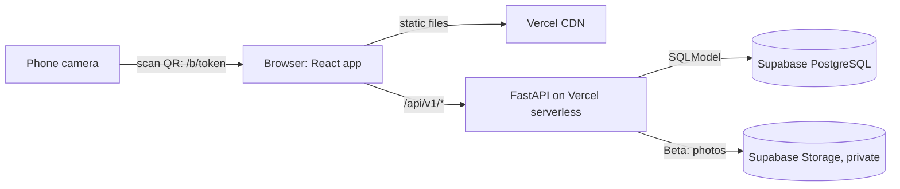
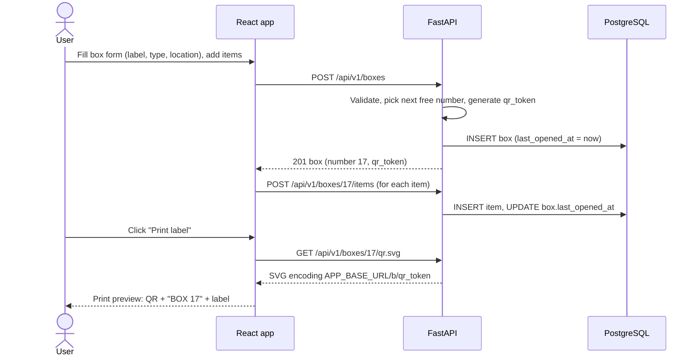
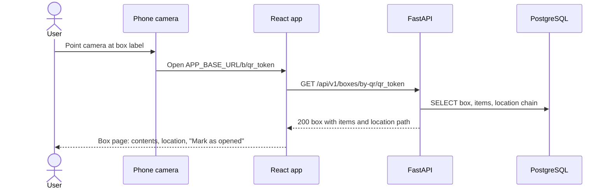
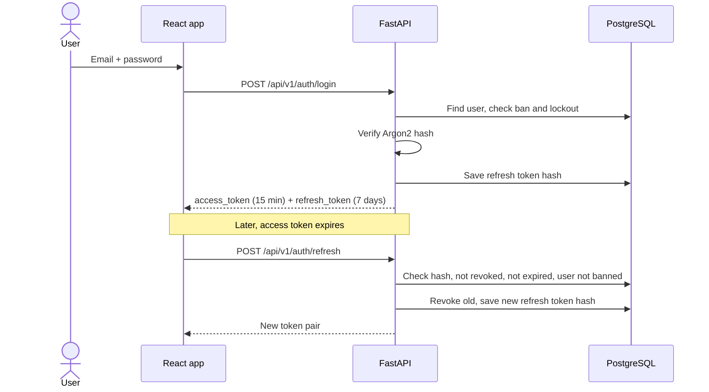
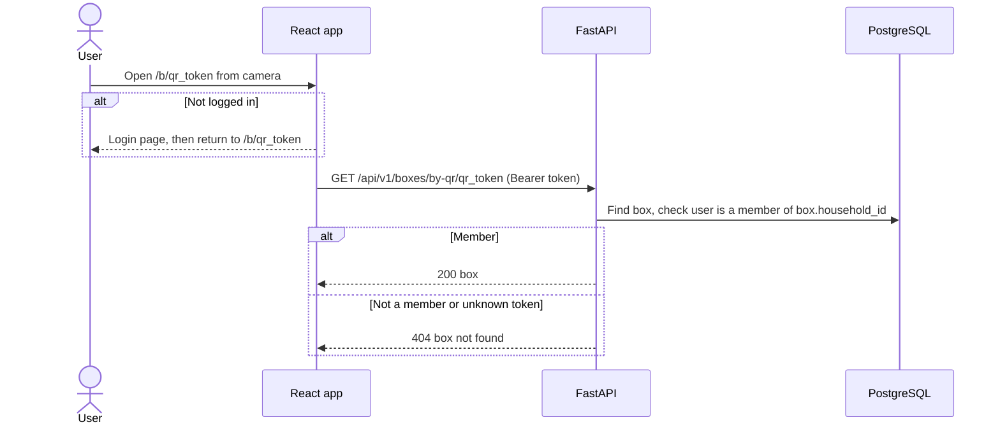
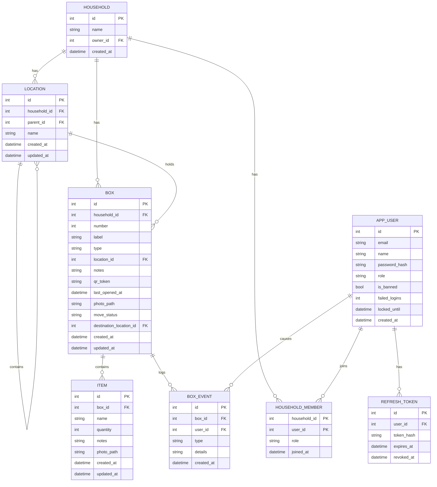

# Technical Design Document (TDD): BoxBrain

| | |
|---|---|
| **Product** | BoxBrain |
| **Document** | Technical Design Document (TDD) |
| **Version** | 1.0 |
| **Date** | October 2026 |
| **Author** | Rifat |
| **Related docs** | [PRD](01-prd.md) · [SRS](02-srs.md) |

---

## 1. Overview

This document explains how BoxBrain will be built: the stack, the architecture, the data model, QR codes and labels, search, the REST API and the security design. Requirement IDs (FR-xx, NFR-xx) refer to the [SRS](02-srs.md).

## 2. Tech stack

| Layer | Choice | Release | Why |
|---|---|---|---|
| Backend | FastAPI (Python) | MVP | Fast to write, automatic OpenAPI docs, Pydantic validation |
| ORM | SQLModel | MVP | One class for both the table and the schema |
| Database | Supabase PostgreSQL (production), SQLite (local) | MVP | Free hosted Postgres; SQLite needs no setup locally |
| QR codes | `segno` (Python) | MVP | Pure Python, no system libraries, outputs SVG that prints sharply at any size |
| Frontend | React + Vite, React Router | MVP | Fast dev server; `/b/:token` route for QR links |
| Printing | Browser print with CSS `@media print` | MVP | No PDF library needed; works on any computer |
| Hosting | Vercel (static frontend + Python serverless function for `/api/*`) | MVP | Free, deploys from GitHub |
| Migrations | Alembic | Beta | Safe schema changes once real data exists |
| Auth | PyJWT (access + refresh tokens) | Beta | Simple, stateless access tokens |
| Password hashing | Argon2 (`argon2-cffi`) | Beta | Current recommended password hash |
| File storage | Supabase Storage (private bucket, signed URLs) | Beta | Box and item photos stay private |
| Fuzzy search | PostgreSQL `pg_trgm` extension | Beta | Typo-tolerant search inside the database |

## 3. Architecture



Vercel serves the React build as static files. Every request to `/api/*` is routed by `vercel.json` to the FastAPI app, which runs as a serverless function and talks to Supabase PostgreSQL. A QR code is just a link to the React app (`/b/<qr_token>`), so the phone's normal camera opens it in the browser, and the React page then loads the box from the API.

### 3.1 Request flow

1. The browser calls an endpoint, for example `GET /api/v1/search?q=passport`.
2. Vercel routes it to `api/index.py`.
3. The FastAPI router validates query and body with Pydantic schemas (`422` on failure).
4. Dependencies run: database session, and in Beta the current user and household membership checks.
5. The router calls a service function, which reads or writes through SQLModel.
6. The response is serialised through a response schema.

### 3.2 Create a box and print its label (MVP)



### 3.3 Scan a QR code (MVP)



### 3.4 Login and refresh (Beta)



### 3.5 Scan a QR code with households (Beta)



## 4. Project structure

```
boxbrain/
├── api/
│   ├── index.py              # FastAPI app, mounts routers under /api/v1, docs at /api/docs
│   ├── core/
│   │   ├── config.py         # Settings read from environment variables
│   │   ├── db.py             # Engine and session dependency
│   │   └── security.py       # Beta: JWT, Argon2, membership and role checks
│   ├── models/               # SQLModel tables: location, box, item, user, refresh_token, household, member, box_event
│   ├── schemas/              # Request and response models
│   ├── routers/              # locations, boxes, items, search, auth, users, households, admin
│   └── services/             # locations (paths, cycle check), boxes, search, qr, events, stats
├── frontend/
│   └── src/
│       ├── api/              # fetch helpers
│       ├── components/       # BoxCard, ItemList, LocationTree, LocationPicker, QrLabel, SearchBar
│       └── pages/            # Home, BoxPage, ScanPage (/b/:token), Search, Locations, Stale, Label,
│                             # (Beta) Login, Profile, Households, Moving, LabelSheet, Admin
├── scripts/seed.py           # Sample locations, boxes and items
├── alembic/                  # Beta migrations
├── docs/                     # PRD, SRS, TDD
├── requirements.txt
└── vercel.json
```

## 5. Data model

### 5.1 ERD



### 5.2 Tables

**MVP**

- `location`: a tree through `parent_id` (null for top-level locations). Unique on `(parent_id, lower(name))`.
- `box`: `number` is unique, `qr_token` is unique and indexed. `last_opened_at` starts at the creation time. Indexes on `location_id` and `last_opened_at`.
- `item`: belongs to one box and is deleted with it (`ON DELETE CASCADE`). Index on `box_id`, and on `lower(name)` for search.

**Beta additions**

- `household`, `household_member` (`role` is `owner` or `member`), `app_user` (`role` is `user` or `admin`), `refresh_token` (stores only a SHA-256 hash), `box_event`.
- `location.household_id` and `box.household_id`. Box `number` becomes unique per household: `UNIQUE (household_id, number)`. Items get their household through their box.
- `box.photo_path`, `item.photo_path`: paths inside the private storage bucket, not public URLs.
- `box.move_status` (default `none`) and `box.destination_location_id`.
- When Beta is released, the MVP demo data is moved into a "Demo" household owned by an admin account.

## 6. Locations and paths

- Locations form a tree, at most 5 levels deep (FR-01).
- **Path:** a household has at most a few hundred locations, so the service loads all of them once per request into a dictionary `{id: (name, parent_id)}` and walks up the parents to build each path. This is simpler than a recursive SQL query and fast enough.
- **Cycle check (FR-02):** before moving location `A` under `P`, walk up from `P`. If `A` appears, the move is rejected with `400`. The new depth is also checked against the limit.
- **Box count per location** includes boxes in sub-locations when `include_sublocations=true`, found by collecting all descendant IDs from the same dictionary.

## 7. QR codes and labels

- Each box gets `qr_token = secrets.token_urlsafe(9)`, which is 12 URL-safe characters and 72 random bits (NFR-06).
- The QR code encodes `APP_BASE_URL/b/<qr_token>`. It points to the **box**, not its location, so moving a box never needs a new label.
- `GET /api/v1/boxes/{id}/qr.svg` creates the code with `segno` (error correction level M so a slightly scratched label still scans) and returns `image/svg+xml`.
- **Single label (MVP):** a React page lays out the QR code, the box number in large text (`BOX 17`) and the label, sized for about 5 × 3 cm, and calls `window.print()`.
- **Label sheet (Beta):** a React page takes several box IDs and lays out a 3 × 7 grid per A4 page (21 labels, 63.5 × 38.1 mm each, a common sticker sheet size) using CSS `@page` and `break-after: page`.
- If the QR is damaged, the large printed number still identifies the box (NFR-05), and the user can find it in the box list.

## 8. Search design

**MVP (FR-12)**

1. Lowercase the query `q`.
2. One SQL query joins `item → box` and matches `lower(item.name)`, `lower(item.notes)`, `lower(box.label)` and `lower(box.notes)` with `LIKE '%q%'`.
3. Results are ranked: exact item name match first, then name starts with `q`, then name contains `q`, then matches in notes or box label.
4. Each result gets its location path from the location dictionary (section 6).
5. At most 50 results are returned.

Example response:

```json
GET /api/v1/search?q=passport
{
  "results": [
    {
      "item": { "id": 88, "name": "Passport", "quantity": 1 },
      "box": { "id": 4, "number": 4, "label": "Documents" },
      "location_path": ["Bedroom", "Cupboard", "Top shelf"]
    }
  ]
}
```

**Beta (FR-33)**

- Enable `pg_trgm` in Supabase and add a GIN trigram index on `item.name`.
- After the steps above, add items where `similarity(item.name, q) > 0.3` that weren't already matched, ranked below the others by similarity.
- On SQLite (local development) the fuzzy step is skipped, so search still works with exact and partial matches.

## 9. "Not opened since" logic

- `box.last_opened_at` is set to now when:
  - the box is created,
  - the user presses "Mark as opened" (`POST /boxes/{id}/opened`),
  - an item in the box is added, edited, removed, or moved in or out (you have to open the box to do that).
- Moving the whole box to another location doesn't change it.
- `GET /boxes?not_opened_since=2025-10-13` returns boxes with `last_opened_at < 2025-10-13`, oldest first. The UI turns "12 months" into that date.

## 10. Moving mode (Beta)

- `PATCH /boxes/{id}/move-status` with `{"move_status": "unpacked", "destination_location_id": 12, "apply_destination": true}`.
- With `apply_destination = true`, the box's `location_id` is set to the destination in the same transaction, and a `moved` event is recorded.
- Allowed transitions follow the state diagram in the SRS; anything else returns `409`.
- `GET /households/{id}/moving-summary` returns counts per status, for example `{"packed": 7, "in_transit": 0, "unpacked": 5}`.

## 11. REST API

All endpoints are under `/api/v1`. OpenAPI docs are at `/api/docs` (not `/docs`, because `vercel.json` sends only `/api/*` to the backend). Errors use FastAPI's default shape `{"detail": "..."}`.

### 11.1 MVP endpoints

In the MVP every endpoint can be called by anyone, since there are no accounts.

| Method | Path | Description |
|---|---|---|
| `GET` | `/health` | Health check |
| `GET` | `/locations` | All locations with parent, path and box count |
| `POST` | `/locations` | Create location |
| `GET` | `/locations/{id}` | Location with its sub-locations and boxes |
| `PATCH` | `/locations/{id}` | Rename or move under another parent |
| `DELETE` | `/locations/{id}` | Delete an empty location |
| `GET` | `/boxes` | List boxes. Query: `location_id`, `include_sublocations`, `type`, `q`, `not_opened_since`, `sort` (`number`, `label`, `last_opened_at`), `limit` (default 50, max 100), `offset` |
| `POST` | `/boxes` | Create box (number optional) |
| `GET` | `/boxes/{id}` | Box with items and location path |
| `PATCH` | `/boxes/{id}` | Edit box or move it (`location_id`) |
| `DELETE` | `/boxes/{id}` | Delete box and its items |
| `GET` | `/boxes/by-qr/{qr_token}` | Box for a scanned QR code |
| `GET` | `/boxes/{id}/qr.svg` | QR code image |
| `POST` | `/boxes/{id}/opened` | Mark as opened |
| `POST` | `/boxes/{id}/items` | Add item |
| `PATCH` | `/items/{id}` | Edit item or move it (`box_id`) |
| `DELETE` | `/items/{id}` | Remove item |
| `GET` | `/search` | "Where is my X?" Query: `q` |

Example create request:

```json
POST /api/v1/boxes
{
  "label": "Winter clothes",
  "type": "cardboard_box",
  "location_id": 3,
  "notes": "Bottom of the pile"
}
```

Response `201`:

```json
{
  "id": 17,
  "number": 17,
  "label": "Winter clothes",
  "type": "cardboard_box",
  "location_id": 3,
  "location_path": ["Storage room"],
  "qr_token": "q8Zr2LkPw0aT",
  "last_opened_at": "2026-10-13T20:15:00+06:00",
  "items": []
}
```

### 11.2 Beta endpoints

From Beta on, every location, box, item and search endpoint above requires login and checks household membership. `GET /locations`, `GET /boxes` and `GET /search` take a `household_id` query parameter, and `POST /locations` and `POST /boxes` take `household_id` in the body. Deleting boxes and locations becomes owner-only.

| Method | Path | Who can call | Description |
|---|---|---|---|
| `POST` | `/auth/register` | Guest | Create account and personal household |
| `POST` | `/auth/login` | Guest | Get access and refresh tokens |
| `POST` | `/auth/refresh` | Holder of refresh token | Rotate tokens |
| `POST` | `/auth/logout` | User | Revoke refresh token |
| `GET` | `/users/me` | User | Own profile |
| `PATCH` | `/users/me` | User | Change name |
| `POST` | `/users/me/password` | User | Change password |
| `GET` | `/households` | User | Households I belong to, with my role |
| `POST` | `/households` | User | Create household (caller becomes owner) |
| `GET` | `/households/{id}` | Member, owner | Household details |
| `PATCH` | `/households/{id}` | Owner | Rename |
| `DELETE` | `/households/{id}` | Owner | Delete household and all its data |
| `GET` | `/households/{id}/members` | Member, owner | List members |
| `POST` | `/households/{id}/members` | Owner | Add member by email |
| `DELETE` | `/households/{id}/members/{user_id}` | Owner (remove), member (leave themselves) | Remove member or leave |
| `GET` | `/households/{id}/moving-summary` | Member, owner | Box counts per move status |
| `DELETE` | `/boxes/{id}` | Owner | Delete box (owner-only from Beta) |
| `DELETE` | `/locations/{id}` | Owner | Delete location (owner-only from Beta) |
| `POST` | `/boxes/{id}/photo` | Member, owner | Upload box photo (multipart) |
| `POST` | `/items/{id}/photo` | Member, owner | Upload item photo (multipart) |
| `GET` | `/boxes/{id}/events` | Member, owner | Box history |
| `PATCH` | `/boxes/{id}/move-status` | Member, owner | Set move status and destination |
| `GET` | `/boxes/labels` | Member, owner | Label data for several boxes. Query: `ids` |
| `GET` | `/admin/stats` | Admin | Service stats |
| `GET` | `/admin/users` | Admin | List users |
| `POST` | `/admin/users/{id}/ban` | Admin | Ban user and revoke their refresh tokens |
| `POST` | `/admin/users/{id}/unban` | Admin | Unban user |

## 12. Security design

### 12.1 Authentication (Beta)

- Passwords hashed with Argon2id (`argon2-cffi` defaults).
- Access token: JWT signed with HS256 using `JWT_SECRET`, claims `sub` (user id), `role`, `exp` (15 minutes). Sent as `Authorization: Bearer <token>`.
- Refresh token: random string, 7 days. Only its SHA-256 hash is stored. Each refresh revokes the old token and issues a new one. If a revoked token is used again, all of that user's refresh tokens are revoked.
- Login lockout: `failed_logins` increases on each wrong password. At 5, `locked_until = now + 15 min` and login returns `429`. A successful login resets the counter.
- Changing a password or being banned revokes all refresh tokens.

### 12.2 Authorisation (Beta)

FastAPI dependencies keep the checks in one place:

- `get_current_user`: decodes the JWT, loads the user, rejects banned users with `403`.
- `get_membership(household_id)`: returns the user's role in that household, or raises `404` if they aren't a member (NFR-17).
- `get_box(box_id)`, `get_item(item_id)`, `get_location(location_id)`: load the record, then check membership of its household. Unknown and foreign records both return `404`.
- `require_owner`: `403` unless the membership role is `owner`.
- `require_admin`: `403` unless the global role is `admin`. Admin endpoints never return box or item data.

### 12.3 QR links

- In the MVP, the QR token is the only thing needed to open a box page. That is fine because the MVP holds demo data only (NFR-10).
- In Beta, the token only identifies the box. The user must also be logged in and a member of the box's household, so a lost or photographed label doesn't expose anything.

### 12.4 Photos (Beta)

- Upload checks the content type and size (2 MB), renames the file to `households/<id>/<random>.<ext>` and stores it in a **private** Supabase Storage bucket.
- The API returns a signed URL that expires after 1 hour whenever it returns a box or item with a photo (NFR-18).

### 12.5 Other measures

- Pydantic validation on every input (SRS section 5).
- CORS limited to `FRONTEND_ORIGIN` (Beta).
- Security headers added by a small middleware (Beta).
- Rate limiting with a simple counter table per user and hour, since serverless functions don't share memory (Beta).

## 13. Admin stats (Beta)

`GET /api/v1/admin/stats` returns only counts, never contents:

```json
{
  "users": { "total": 48, "banned": 1, "new_last_7_days": 6 },
  "households": 41,
  "boxes": 615,
  "items": 4210,
  "boxes_created_per_week": [ { "week": "2026-W40", "count": 52 } ]
}
```

## 14. Configuration

| Variable | Release | Description |
|---|---|---|
| `DATABASE_URL` | MVP | Supabase Postgres URL in production, `sqlite:///./boxbrain.db` locally |
| `APP_BASE_URL` | MVP | Public URL of the app, used inside QR codes (for example `https://boxbrain.vercel.app`) |
| `FRONTEND_ORIGIN` | MVP | Frontend URL, used for CORS |
| `JWT_SECRET` | Beta | Long random secret for signing tokens |
| `ACCESS_TOKEN_MINUTES` | Beta | Default `15` |
| `REFRESH_TOKEN_DAYS` | Beta | Default `7` |
| `SUPABASE_URL` | Beta | Project URL for Storage |
| `SUPABASE_SERVICE_KEY` | Beta | Server-only key for uploads and signed URLs |
| `STORAGE_BUCKET` | Beta | Private bucket for photos |

Secrets go in a local `.env` file (listed in `.gitignore`) and in Vercel's project environment variables. They are never committed.

`APP_BASE_URL` must be the final production URL before any labels are printed, because it is baked into every QR code.

## 15. Supabase setup

1. Create a Supabase project and copy the connection string from **Connect**.
2. Use the **transaction pooler** connection string (port 6543) for `DATABASE_URL`, because serverless functions open many short connections.
3. In `core/db.py`, create the engine with `poolclass=NullPool` so connections aren't kept between invocations.
4. Beta: enable the `pg_trgm` extension, and create a **private** Storage bucket named in `STORAGE_BUCKET`.

## 16. Migrations

- **MVP:** tables are created with `SQLModel.metadata.create_all()` when the seed script runs. This is fine while there is only demo data.
- **Beta:** Alembic is added. The first migration matches the MVP schema. The second adds users, households, members, refresh tokens and box events, adds `household_id` to locations and boxes, moves existing demo data into a "Demo" household, and then makes `household_id` required. Migrations are run by hand against Supabase before each deploy.

## 17. Deployment

1. Push to GitHub; Vercel builds a preview for every pull request.
2. `vercel.json` routes `/api/(.*)` to `api/index.py` and everything else to the React build, with a fallback to `index.html` so `/b/<token>` works on a fresh page load.
3. Environment variables are set in the Vercel dashboard for Preview and Production.
4. Merging into `main` deploys to production. MVP is tagged `v0.1.0`, Beta `v0.2.0`.

## 18. Risks

| Risk | Impact | Mitigation |
|---|---|---|
| Inventory gets out of date because people don't update it | Search gives wrong answers | Quick add / remove right on the QR box page; item changes update "opened" automatically |
| QR label gets wet, torn or scratched | Box can't be scanned | Error correction level M, large printed box number, tape over the label |
| `APP_BASE_URL` changes after labels are printed | Old labels point to a dead link | Fix the production URL before printing; keep the old domain redirecting if it ever changes |
| Shared demo data in the MVP | Anyone can edit it | Sample data only, with a banner; Beta adds private households |
| A household member deletes things by mistake | Data loss | Deleting boxes and locations is owner-only in Beta, with a confirm dialog |
| Private photos leaked through public links | Privacy issue | Private bucket and short-lived signed URLs |
| Serverless cold starts on Vercel | First request is slow | Small dependency list; accept for a class project |
| Supabase free tier pauses inactive projects | Demo fails | Open the app the day before the demo |
| Scope creep (barcodes, valuations, insurance) | Project doesn't finish | Listed as out of scope in the PRD |
